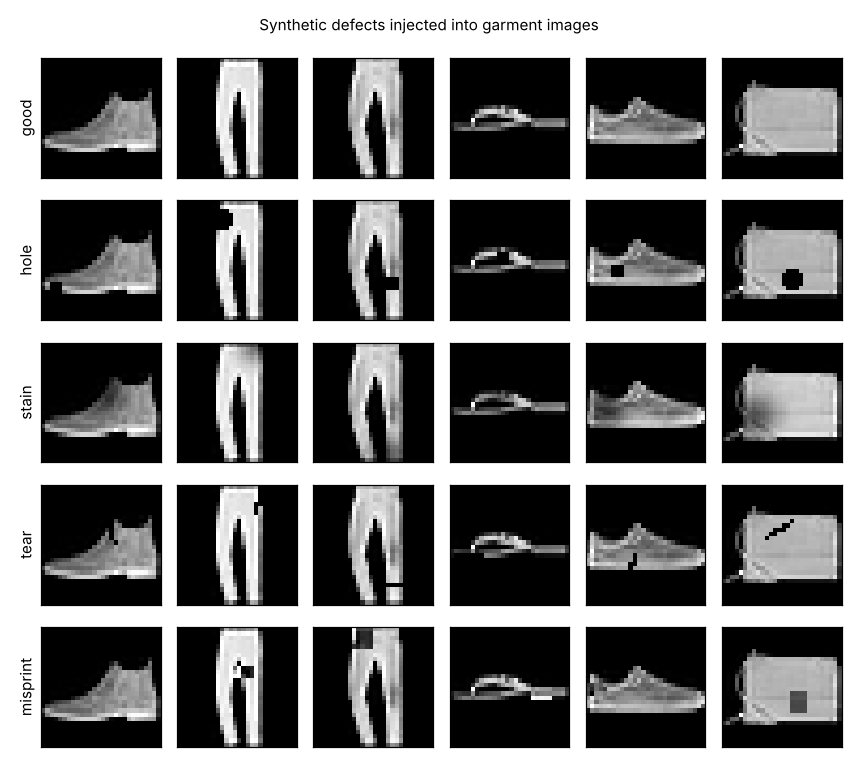
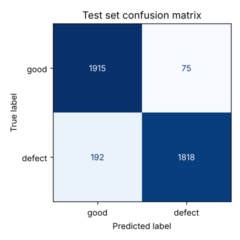

# QC Vision — visual quality inspection with machine learning

Detect defective products from photos and **accept or reject a whole shipment lot** automatically.

The pipeline is demonstrated on garments (holes, stains, tears and print errors), but it is product-agnostic: point it at a folder of `good/` and `defect/` images of anything — textiles, packaging, printed parts — and it trains the same way.



## How it works

1. **Data.** Garment images come from [Fashion-MNIST](https://github.com/zalandoresearch/fashion-mnist). Because public datasets of *defective* clothing are rare, defects are injected synthetically (`qcvision/data.py`): holes, stains (soft dark blobs), tears (thin lines) and misprints (inverted patches), placed at random on the garment.
2. **Model.** A small convolutional neural network (PyTorch) with a global max-pool, so a defect anywhere in the image activates the "defect" output. A classical baseline (HOG features + gradient boosting, scikit-learn) is included for comparison.
3. **Item decision.** Each item gets a defect probability; above a threshold (default 0.5) it is flagged.
4. **Lot decision.** A lot is rejected when its share of flagged items exceeds a tolerance (default 5 %), the way an acceptance-sampling check works on a production line.

## Results

Test set: 4,000 held-out garments, half with a defect.

| Model | Accuracy | F1 | ROC AUC | False alarms |
|---|---|---|---|---|
| **CNN (PyTorch)** | **93.3 %** | **0.93** | **0.98** | **3.8 %** |
| HOG + gradient boosting (baseline) | 66.5 % | 0.66 | 0.74 | 32.3 % |

Recall per defect type (CNN): hole 94 %, tear 93 %, stain 87 %, misprint 87 %.



Example lot inspection (40 items, 5 defective):

```
item_023_misprint.png   1.0000   True
item_024_tear.png       0.9590   True
item_032_hole.png       1.0000   True
item_037_tear.png       0.5208   True
...
Lot decision: REJECT  |  5/40 items flagged (12.5%, tolerance 5.0%)
```

## Quick start

```bash
pip install torch --index-url https://download.pytorch.org/whl/cpu   # CPU build of PyTorch
pip install -e ".[dev]"

# Train (downloads Fashion-MNIST on first run, ~15 min on a laptop CPU)
qcvision train --n-train 60000 --epochs 10

# Generate a sample shipment and inspect it
qcvision demo-lot --out data/demo_lot
qcvision inspect --lot data/demo_lot --csv reports/lot_report.csv
```

A pre-trained model is included in `models/qc_model.joblib`, so `inspect` and the API work right away.

### Your own products

```
my_dataset/
  good/     *.png | *.jpg
  defect/   *.png | *.jpg
```

```bash
qcvision train --source folder --data my_dataset
```

### REST API

```bash
uvicorn qcvision.api:app --reload
# interactive docs at http://localhost:8000/docs
```

| Endpoint | Description |
|---|---|
| `POST /inspect/item` | one image → defect probability |
| `POST /inspect/lot` | several images → per-item results + ACCEPT / REJECT |
| `GET /model` | metrics of the loaded model |

```bash
curl -F "file=@data/demo_lot/item_032_hole.png" localhost:8000/inspect/item
```

## Tests

```bash
pytest -q
```

Covers defect generation, dataset loading, both models, the lot decision rule and the API.

## Project structure

```
src/qcvision/
  data.py         Fashion-MNIST loader, synthetic defects, folder datasets
  model.py        CNN (PyTorch) and HOG + gradient boosting baseline
  inspect_lot.py  item scoring and lot accept/reject rule
  cli.py          train / demo-lot / inspect commands
  api.py          FastAPI service
tests/            pytest suite
reports/          metrics and confusion matrix from the last training run
```

## Ideas for next steps

- Train on real photos (e.g. the MVTec AD dataset) with a pretrained backbone.
- Localise defects with a heatmap (Grad-CAM) so operators see *where* the problem is.
- Anomaly detection trained on good items only, for defect types never seen before.

## License

MIT — Dhia Kanzari
